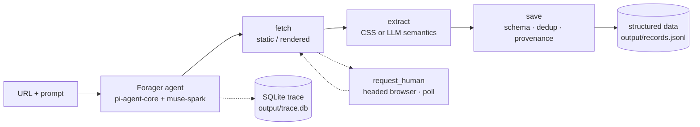

<p align="center">
  <picture>
    <source media="(prefers-color-scheme: dark)" srcset="./Resources/Brand/forager-wordmark-dark.svg">
    <source media="(prefers-color-scheme: light)" srcset="./Resources/Brand/forager-wordmark-light.svg">
    
  </picture>
</p>

<p align="center">
  One prompt, any website — an LLM agent that forages the web, asks for your help when it hits a wall, and learns to forge its own tools.
</p>

<p align="center">
  
  
  
  
</p>

<p align="center">
  English | <a href="./README_zh.md">简体中文</a>
</p>

---

### Overview

Forager turns a URL and a single sentence of natural language into a running web-scraping agent. Instead of you hand-writing selectors and pagination logic, an LLM agent — built on `pi-agent-core` and `muse-spark` — explores the site itself: it fetches pages, reads them, follows links, decides what to extract, and saves structured records. Everything it does goes through four essential tools: **fetch** (get), **extract** (understand), **save** (keep), and **request_human** (ask). When it hits a login wall, a CAPTCHA, or a slider, it hands the browser to you, then detects when you are done and takes over automatically — no Enter key required. Every prompt, response, and tool call is recorded to SQLite, so any run can be replayed and audited.

### Architecture



### Why Forager?

**It asks for help.** Most crawlers treat a login wall or a slider CAPTCHA as a hard failure, then retry blindly or rotate proxies. Forager treats the human as part of the system. Its fourth essential tool, `request_human`, opens a headed browser on the exact page that is blocking it, tells you what to do, and then polls for completion — a success selector, a URL that is no longer the login page, or simply the window being closed. The moment you finish, the agent resumes in the same browser context with your cookies and session intact. No Enter key, no terminal babysitting, and it works even in unattended/background runs.

**It will forge its own tools.** Sites protected by aggressive anti-bot systems (BOSS Zhipin, for example) are not worth brute-forcing through a renderer. The planned P4 layer lets the agent notice that pattern, write a small API-level tool for that specific site, and keep it in a persistent toolbox. This is a roadmap item — `forge_tool`, `run_dynamic_tool`, and toolbox persistence are **coming soon**; today's agent works with the four essential tools.

**Observable by default.** Every run writes a complete trace to SQLite via `node:sqlite` — zero extra dependencies. Every LLM prompt and response in full, every tool call with its arguments, result, duration, error status, and whether it actually persisted a record. `npm run trace` lists runs, replays an event stream, or filters for patterns like "extracted something but never saved it." When the agent behaves strangely, you can prove why.

**Just three verbs.** Crawling looks infinitely varied, but stripped to first principles it is only: get a page, understand it, keep what matters. Forager refuses to grow a tool per technique. Static vs. rendered fetching is a parameter of `fetch`; deterministic CSS extraction vs. semantic LLM extraction is a parameter of `extract`. Strategy lives in arguments, not in an ever-growing toolbox — so the agent composes three verbs into any scraping task.

### How it works

The four essential tools, each with strategy folded into its parameters:

- **`fetch(url, render?)`** — Retrieves a page and the links inside it. Static by default; pass `render=true` to re-fetch through headless Chromium when the content is missing or JS-gated. Returned `links` are how the agent finds "next page" and paginates — pagination is part of fetching, not a separate tool.
- **`extract(content, instruction, selector?)`** — Understands a page. With a CSS `selector` (including `::attr(x)`) it uses cheerio for fast, zero-model-cost extraction; without one it follows the natural-language `instruction` through LLM semantic extraction.
- **`save(data, schema?, dedup_key?, source_url?)`** — Enforces a data contract: missing required fields are rejected (`schema_missing`), duplicate `dedup_key`s are skipped (`duplicate`), and all-empty records are filtered (`all_empty`). `source_url` provides provenance and doubles as the default dedup key.
- **`request_human(reason, url, wait_mode)`** — Asks a person to log in, solve a CAPTCHA, or drag a slider, then waits for an objective completion signal (`success_selector`, `gone_url_pattern`, …) or for the window to close.

A single crawl is a loop: the agent fetches the entry URL, reads the page and its links, extracts the fields your prompt asked for, saves them under the data contract, and decides whether to follow a link and repeat. `list_saved` reports how many records are on disk, and `finish` ends the run when the task is complete. The whole loop is recorded as it happens.

### Quick start

Requires **Node >= 22.19**.

```bash
npm install
npx playwright install chromium
```

Create a `.env` in the project root:

```dotenv
OPENCODE_API_KEY=your_opencode_go_key
# optional, defaults to muse-spark-1.3-contributor
CRAWLER_MODEL=muse-spark-1.3-contributor
```

Run a task:

```bash
npm run crawl -- <url> "<task>"
```

For example:

```bash
npm run crawl -- https://quotes.toscrape.com "Collect the first 3 pages of quotes with author and tags"
```

Records are appended as JSON Lines to `output/records.jsonl`, and the run's trace goes to `output/trace.db`.

### Observability

Each run prints its `run_id` when it finishes:

```bash
# List all runs, newest first
npm run trace
npm run trace -- runs

# Replay the full event stream of one run
npm run trace -- run <run_id>

# Find runs that extracted data but never saved it
npm run trace -- --pattern extract-no-save

# Point at a different trace database
npm run trace -- --db <path>
```

The trace holds run metadata (entry URL, task, status, duration, `records_saved`), the complete prompt and response of every LLM interaction, and every tool call with arguments, results, timing, errors, and whether it produced a saved record.

### Verified on

Real sites, real runs — no mocks in the test suite:

| Site | What it exercises |
| --- | --- |
| [quotes.toscrape.com](https://quotes.toscrape.com) / [books.toscrape.com](https://books.toscrape.com) | Multi-page pagination, listing + detail extraction |
| [Hacker News](https://news.ycombinator.com) | Link ranking structures, static HTML |
| [GitHub Trending](https://github.com/trending) | Dynamically rendered content, repo metadata |
| [量子位 (QbitAI)](https://www.qbitai.com) | Chinese news site, article extraction |
| [知乎 (Zhihu)](https://www.zhihu.com) | Login wall — `request_human` handoff, session reuse |
| [BOSS直聘 (BOSS Zhipin)](https://www.zhipin.com) | Slider CAPTCHA + anti-bot risk control |

**A real-API test suite (no mocks)** — run `npm test`.

### Roadmap

- **P4 — adaptive tool forging**: `forge_tool` lets the agent write a site-specific tool when rendering is the wrong approach, `run_dynamic_tool` executes it, and a persistent `toolbox` keeps it for later runs. This is **not implemented yet**; Forager currently ships the four essential tools.
- **Docker sandbox**: run forged tools in an isolated container.

### License

[MPL-2.0](./LICENSE)
