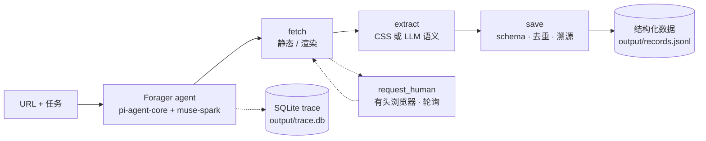

<p align="center">
  <picture>
    <source media="(prefers-color-scheme: dark)" srcset="./Resources/Brand/forager-wordmark-dark.svg">
    <source media="(prefers-color-scheme: light)" srcset="./Resources/Brand/forager-wordmark-light.svg">
    
  </picture>
</p>

<p align="center">
  一句提示，任意网站 —— 一个会主动觅食的 LLM 爬虫：撞墙时向你求助，必要时将学会自己锻造工具。
</p>

<p align="center">
  
  
  
  
</p>

<p align="center">
  <a href="./README.md">English</a> | 简体中文
</p>

---

### 概览

Forager 把一个 URL 和一句自然语言任务，变成一个正在运行的网页抓取 agent。你不再手写选择器和翻页逻辑，而是由基于 `pi-agent-core` 与 `muse-spark` 的 LLM agent 自己去探索站点：取页面、读内容、跟链接、判断该抽什么、保存结构化记录。它的所有动作都收敛到四个本质工具：**fetch**（取）、**extract**（懂）、**save**（存）、**request_human**（求助）。遇到登录墙、验证码或滑块时，它把浏览器交到你手上，随后自动检测你已经完成并接管——不需要按回车。每一次 LLM 交互与工具调用都写入 SQLite，任何一次运行都可回放、可审计。

### 架构



### 为什么是 Forager？

**它会求助。** 多数爬虫把登录墙或滑块验证码视作硬失败，然后盲目重试或换代理。Forager 把人当作系统的一个组件。第四本质工具 `request_human` 会在卡住的那一页弹出有头浏览器，告诉你需要做什么，然后轮询检测完成条件——某个成功后才会出现的元素、URL 已离开登录页，甚至只是窗口被关闭。你一完成，agent 就在同一个浏览器上下文里带着 Cookie 和登录态继续抓取。不用按回车，不用守着终端，后台无人值守时同样有效。

**它将学会自己造工具。** 面对反爬极强的站点（例如 BOSS 直聘），用渲染硬闯并不划算。规划中的 P4 层会让 agent 识别这种模式，为特定站点写一个小型 API 级工具，并存入持久化工具箱。这一项属于路线图——`forge_tool`、`run_dynamic_tool` 与 toolbox 持久化**尚未实现**；当前的 agent 只使用四个本质工具。

**默认可观测。** 每次运行都通过 `node:sqlite` 把完整 trace 写入 SQLite，零额外依赖。每一次 LLM 的完整 prompt 与 response、每一次工具调用的参数、结果、耗时、是否报错、是否真正落盘，全部记录。`npm run trace` 可以列出运行、回放事件流，或筛选「抽到了但没存」这类模式。agent 行为异常时，你能拿出根因。

**只有三个动词。** 抓取看似千变万化，回归第一性原理只有三件事：取一个页面、读懂它、把有用的存下来。Forager 拒绝为每种技术各造一个工具。静态抓取还是渲染抓取，是 `fetch` 的参数；CSS 确定性提取还是 LLM 语义提取，是 `extract` 的参数。策略内化为参数而不是不断膨胀的工具箱，agent 才能用三个动词组合出任意抓取任务。

### 工作原理

四个本质工具，策略差异全部内化为参数：

- **`fetch(url, render?)`** —— 取回页面内容与其中的链接。默认静态抓取；内容缺失或被 JS 阻塞时传 `render=true`，改用无头 Chromium 重新获取。返回的 `links` 就是 agent 找到「下一页」并翻页的依据——分页内化于取，不是独立工具。
- **`extract(content, instruction, selector?)`** —— 读懂页面。给了 CSS `selector`（支持 `::attr(x)` 后缀）就走 cheerio 确定性提取，快速且零模型成本；不给则按自然语言 `instruction` 走 LLM 语义抽取。
- **`save(data, schema?, dedup_key?, source_url?)`** —— 执行数据契约：缺字段拒绝（`schema_missing`）、同 `dedup_key` 跳过（`duplicate`）、内容全空过滤（`all_empty`）。`source_url` 用于溯源，同时作为默认去重键。
- **`request_human(reason, url, wait_mode)`** —— 请人完成登录、验证码或滑块拖拽，然后等待客观的完成信号（`success_selector`、`gone_url_pattern` 等）或窗口关闭。

一次抓取就是一个循环：agent 取入口页，读页面及其链接，按你的任务抽取字段，在数据契约下保存，再决定是否跟随链接继续。`list_saved` 汇报已落盘记录数与路径，`finish` 在任务完成时结束运行。整个循环边跑边记录。

### 快速开始

需要 **Node >= 22.19**。

```bash
npm install
npx playwright install chromium
```

在项目根目录创建 `.env`：

```dotenv
OPENCODE_API_KEY=你的 OpenCode Go 密钥
# 可选，默认 muse-spark-1.3-contributor
CRAWLER_MODEL=muse-spark-1.3-contributor
```

运行任务：

```bash
npm run crawl -- <url> "<任务>"
```

例如：

```bash
npm run crawl -- https://quotes.toscrape.com "抓取前 3 页名言，保存内容、作者和标签"
```

记录以 JSON Lines 追加到 `output/records.jsonl`，本次运行的 trace 写入 `output/trace.db`。

### 可观测性

每次运行结束会打印本次的 `run_id`：

```bash
# 按时间列出所有运行
npm run trace
npm run trace -- runs

# 回放某次运行的完整事件流
npm run trace -- run <run_id>

# 筛选「extract 有产出但没 save」的运行
npm run trace -- --pattern extract-no-save

# 指定其他 trace 数据库
npm run trace -- --db <path>
```

trace 包含运行元信息（入口 URL、任务、状态、耗时、`records_saved`）、每次 LLM 交互的完整 prompt 与 response，以及每次工具调用的参数、结果、耗时、错误与是否落盘。

### 真实验证

真实站点、真实运行，测试不使用 mock：

| 站点 | 验证的能力 |
| --- | --- |
| [quotes.toscrape.com](https://quotes.toscrape.com) / [books.toscrape.com](https://books.toscrape.com) | 多页翻页、列表 + 详情抽取 |
| [Hacker News](https://news.ycombinator.com) | 链接排序结构、静态 HTML |
| [GitHub Trending](https://github.com/trending) | 动态渲染内容、仓库元数据 |
| [量子位 (QbitAI)](https://www.qbitai.com) | 中文资讯站点、正文抽取 |
| [知乎 (Zhihu)](https://www.zhihu.com) | 登录墙 —— `request_human` 交接与登录态复用 |
| [BOSS直聘 (BOSS Zhipin)](https://www.zhipin.com) | 滑块验证码 + 反爬风控 |

**真实 API 测试套件（零 mock）**——运行 `npm test`。

### 路线图

- **P4 —— 自适应造工具**：`forge_tool` 让 agent 在渲染不是正确解法时编写站点专用工具，`run_dynamic_tool` 执行它，持久化的 `toolbox` 供后续运行复用。该能力**尚未实现**，当前 Forager 只提供四个本质工具。
- **Docker 沙箱**：在隔离容器中运行锻造出的工具。

### 许可证

[MPL-2.0](./LICENSE)
